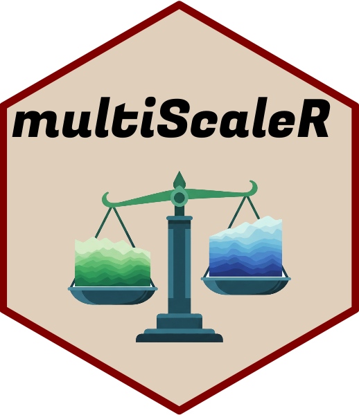

<!-- README.md is generated from README.Rmd. Please edit that file -->

# multiScaleR 

## Overview

multiScaleR is an R package to identify the scale of effect of spatial
environmental variables in regression analyses.

Functions to simulate data with known scales of effect are included with
this package.

## Installation

Install the CRAN release with:

``` r
install.packages("multiScaleR")
```

If installing from GitHub on Windows, you may need Rtools to compile the
package from source. Choose the Rtools release that matches your version
of R and follow the installation instructions at
<https://cran.r-project.org/bin/windows/Rtools/>.

Then execute the following commands in R:

``` r
# Install 'remotes' package, if needed
if (!requireNamespace("remotes", quietly = TRUE)) {
  install.packages("remotes", repos = "https://cloud.r-project.org")
}

remotes::install_github("wpeterman/multiScaleR", 
                        build_vignettes = TRUE) # Install & build vignette

library(multiScaleR) # Load the package
```

The package vignettes provide worked analyses of simulated data and
explain the main workflows.

<p align="center">


</p>
