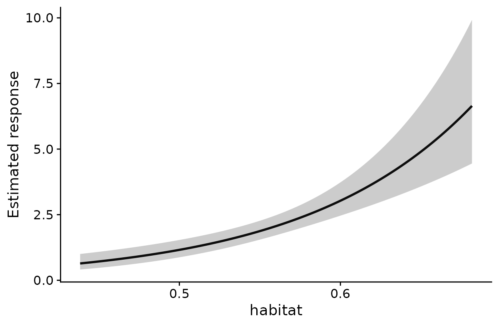
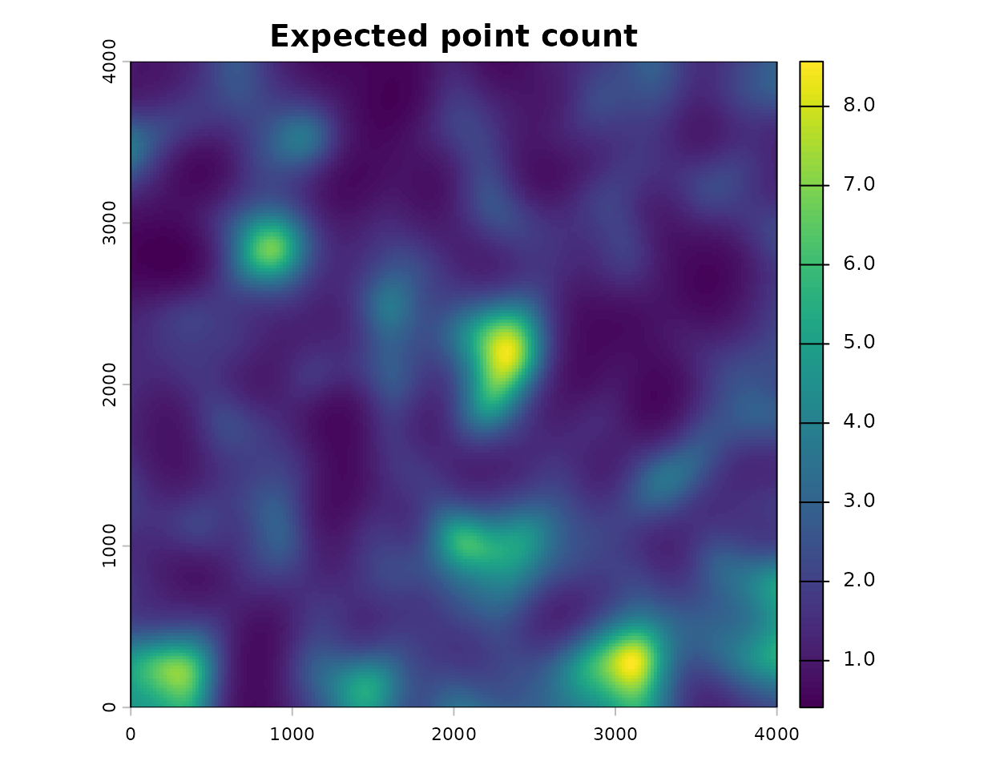

# 16. Combine Data Sets to Estimate a Shared Scale of Effect

## What this vignette covers

Many studies gather more than one kind of data on the same landscape:
point counts at some sites, detection and nondetection surveys at
others, acoustic recorders or cameras somewhere else. Each data set can
estimate the scale of effect on its own, but small or binary data sets
often estimate it poorly. Analyzed together, they can estimate a shared
scale more precisely, and they can show whether the scale really differs
among them.

[`multiScale_joint()`](https://wpeterman.github.io/multiScaleR/reference/multiScale_joint.md)
combines data sets that you have already fitted with
[`multiScale_optim()`](https://wpeterman.github.io/multiScaleR/reference/multiScale_optim.md).
Each data set keeps its own response, model class, and coefficients. The
joint fit ties together only what you choose: the scale of effect of
each landscape covariate and, if you wish, its regression coefficient.
This vignette works through one simulated example with three surveys and
shows how to

1.  estimate one scale of effect from two surveys and read the output,
2.  test whether a common scale is supported,
3.  allow for surveys that revisit the same sites,
4.  share a landscape coefficient between surveys,
5.  account for a survey that measures its response over an area rather
    than at a point, and
6.  use the fitted model for plots and maps.

Read
[`vignette("v01-quickstart", package = "multiScaleR")`](https://wpeterman.github.io/multiScaleR/articles/v01-quickstart.md)
first.
[`vignette("v02-user-guide", package = "multiScaleR")`](https://wpeterman.github.io/multiScaleR/articles/v02-user-guide.md)
explains profile likelihood intervals and model selection with AIC, and
[`vignette("v09-estimates-and-intervals", package = "multiScaleR")`](https://wpeterman.github.io/multiScaleR/articles/v09-estimates-and-intervals.md)
explains what each interval includes.

> **Experimental.**
> [`multiScale_joint()`](https://wpeterman.github.io/multiScaleR/reference/multiScale_joint.md)
> and
> [`footprint_sd()`](https://wpeterman.github.io/multiScaleR/reference/footprint_sd.md)
> are new. Their arguments and results may change in a later release
> without a deprecation period.

## How a joint fit works

For any candidate scale of effect,
[`multiScale_optim()`](https://wpeterman.github.io/multiScaleR/reference/multiScale_optim.md)
smooths the landscape at that scale, refits your model, and records its
maximized log-likelihood.
[`multiScale_joint()`](https://wpeterman.github.io/multiScaleR/reference/multiScale_joint.md)
does the same refit for every data set and adds the log-likelihoods. It
then searches for the scales that maximize this sum. The *joint
log-likelihood* is therefore the sum of the data sets’ own
log-likelihoods, each maximized over that data set’s own coefficients.

Adding log-likelihoods treats the data sets as independent pieces of
evidence once the landscape covariates are accounted for. Section 6
shows how to check this when surveys share sites.

The `scales` argument sets what the data sets share.

| `scales =` | What the data sets share | Use it when |
|:---|:---|:---|
| `"common"` | One scale for each landscape covariate | Every survey measures its response at a point and should respond to the landscape over the same distance |
| `"separate"` | Nothing. Each data set has its own scale | As the reference model. It reproduces the separate fits |
| `"footprint"` | One ecological scale, seen through each survey’s sampling footprint | Some surveys measure the response over an area, such as the detection radius of a recorder |
| `"footprint_scaled"` | As `"footprint"`, with every footprint multiplied by an estimated factor `kappa` | The footprint sizes are uncertain |

Two further arguments extend the model. `share` names landscape
covariates whose regression coefficient is also shared, and `cluster`
identifies sites that more than one survey visited.

## Simulate three surveys of one landscape

The example uses one continuous habitat layer on a landscape 4 km on a
side. The true *ecological scale of effect* (the scale at which the
landscape affects the animals) is a Gaussian kernel with sigma = 150 m.
Three surveys sample this landscape:

- **Point counts** at 60 sites record the number of individuals, a
  Poisson count.
- **Presence and absence** at 80 sites records whether at least one
  individual is present. Forty of these sites are count sites visited a
  second time.
- **Acoustic recorders** at 40 sites count calls detected within 300 m.
  Each recorder therefore summarizes a disk of landscape rather than a
  point.

Revisited sites also share an unmeasured *site effect*, a local
influence on abundance that the habitat raster does not capture. That is
common in real surveys and matters in Section 6.

``` r

# A continuous habitat layer: 200 x 200 cells of 20 m
rs <- sim_rast(dim = 200, resolution = 20, user_seed = 2024)
habitat <- rs[["cont1"]]
names(habitat) <- "habitat"
# sim_rast() returns no coordinate reference system. A projected CRS makes
# the map units meters and lets kernel_scale.raster() match buffers later.
crs(habitat) <- "EPSG:32617"

max_D <- 800        # buffer radius, in meters, for every survey
sigma_true <- 150   # ecological scale of effect, in meters

# The recorders detect calls within 300 m. footprint_sd() turns that disk
# into a standard deviation, and the landscape a recorder sees is smoothed
# at the larger apparent scale sqrt(sigma^2 + footprint^2).
tau_acoustic <- footprint_sd("disk", 300)
sigma_acoustic <- sqrt(sigma_true^2 + tau_acoustic^2)
c(footprint = tau_acoustic, apparent = sigma_acoustic)
#> footprint  apparent 
#>   150.000   212.132

# Survey locations at least max_D + 50 m from the raster edge
random_points <- function(n) {
  xy <- data.frame(x = runif(n, 850, 3150), y = runif(n, 850, 3150))
  vect(xy, geom = c("x", "y"), crs = "EPSG:32617")
}

# Habitat smoothed at scale `sigma` around each point, standardized across
# points. kernel_prep() returns it in kernel_dat when given `sigma`.
smoothed_at <- function(pts, sigma) {
  kernel_prep(pts, habitat, max_D = max_D, kernel = "gaussian", sigma = sigma,
              verbose = FALSE)$kernel_dat$habitat
}

set.seed(4)
count_pts    <- random_points(60)
presence_pts <- rbind(count_pts[1:40], random_points(40))  # 40 revisited sites
acoustic_pts <- random_points(40)
count_pts$site    <- paste0("site", 1:60)
presence_pts$site <- c(count_pts$site[1:40], paste0("site", 61:100))

# Unmeasured site effects, shared by both surveys at a revisited site
site_effect <- setNames(rnorm(100, mean = 0, sd = 0.4), paste0("site", 1:100))

# Log expected abundance rises by 0.6 per standard deviation of habitat
count_pts$count <- rpois(60, exp(0.5 + 0.6 * smoothed_at(count_pts, sigma_true) +
                                   site_effect[count_pts$site]))
# Present when at least one individual is there
presence_pts$present <- as.integer(
  rpois(80, exp(-0.3 + 0.6 * smoothed_at(presence_pts, sigma_true) +
                  site_effect[presence_pts$site])) > 0)
# Calls respond to habitat at the recorders' apparent scale
acoustic_pts$calls <- rpois(40, exp(1.5 + 0.6 * smoothed_at(acoustic_pts, sigma_acoustic)))
```

**How the presence data relate to the counts:** if the number of
individuals at a site is Poisson with mean lambda, the probability that
at least one is present is 1 - exp(-lambda). The complementary log-log
(cloglog) link inverts this relation, so cloglog(p) = log(lambda). A
binomial model with a cloglog link therefore estimates the same habitat
coefficient, on the same scale, as a Poisson model of the counts.
Section 7 uses this to share the coefficient.

## Fit each survey alone

Prepare kernel inputs for each survey with the same raster, and fit each
model with
[`multiScale_optim()`](https://wpeterman.github.io/multiScaleR/reference/multiScale_optim.md)
as in the Quick Start.
[`multiScale_joint()`](https://wpeterman.github.io/multiScaleR/reference/multiScale_joint.md)
matches landscape covariates across data sets by name, so the layer must
have the same name (`habitat`) in every
[`kernel_prep()`](https://wpeterman.github.io/multiScaleR/reference/kernel_prep.md)
call.

``` r

prep <- function(pts) {
  kernel_prep(pts, habitat, max_D = max_D, kernel = "gaussian", verbose = FALSE)
}
in_count    <- prep(count_pts)
in_presence <- prep(presence_pts)
in_acoustic <- prep(acoustic_pts)

dat_count    <- data.frame(count = count_pts$count, site = count_pts$site,
                           in_count$kernel_dat)
dat_presence <- data.frame(present = presence_pts$present, site = presence_pts$site,
                           in_presence$kernel_dat)
dat_acoustic <- data.frame(calls = acoustic_pts$calls, in_acoustic$kernel_dat)

fit_count <- multiScale_optim(
  glm(count ~ habitat, family = poisson, data = dat_count),
  in_count, verbose = FALSE)
fit_presence <- multiScale_optim(
  glm(present ~ habitat, family = binomial(link = "cloglog"), data = dat_presence),
  in_presence, verbose = FALSE)
fit_acoustic <- multiScale_optim(
  glm(calls ~ habitat, family = poisson, data = dat_acoustic),
  in_acoustic, verbose = FALSE)

# Sigma and its standard error from each survey, in meters
alone <- list(counts = fit_count, presence = fit_presence, acoustic = fit_acoustic)
data.frame(sigma = sapply(alone, function(f) f$scale_est$Mean),
           SE    = sapply(alone, function(f) f$scale_est$SE),
           n     = sapply(alone, function(f) nobs(f$opt_mod)))
#>             sigma       SE  n
#> counts   127.6503 25.16474 60
#> presence 129.2601 34.45105 80
#> acoustic 232.8066 26.28108 40
```

**How to read the output:** each row is one survey analyzed alone. The
point counts and the presence data both estimate sigma near 128 m, below
the true 150 m but well within two standard errors of it. The presence
data are binary and carry less information per site, so their standard
error is larger despite more sites. The acoustic estimate is much
larger, about 233 m. That is not a different ecological scale: each
recorder averages the landscape over its 300 m detection radius, which
inflates the scale it appears to respond to (Section 8). The first two
surveys measure their response at a point, so Sections 5 to 7 combine
them, and Section 8 adds the recorders.

## Estimate a common scale

Pass the separate fits as a named list. The names identify the data sets
in the output.

``` r

common <- multiScale_joint(list(counts = fit_count, presence = fit_presence),
                           scales = "common", verbose = FALSE)
common
#> 
#> Joint scale-of-effect fit (experimental)
#> Data sets: counts (glm, n = 60); presence (glm, n = 80)
#> Kernel: gaussian
#> 
#> Scale structure
#>  covariate structure        data_sets shared_coefficient
#>    habitat    common counts, presence              FALSE
#> 
#> Joint parameters (scales in map units)
#>      parameter estimate    SE 95% lower (profile) 95% upper (profile)
#>  sigma:habitat    128.2 20.34               91.72               175.2
#> 
#> Apparent scale in each data set
#>  data_set covariate sigma    SE 95% lower (profile) 95% upper (profile)
#>    counts   habitat 128.2 20.34               91.72               175.2
#>  presence   habitat 128.2 20.34               91.72               175.2
#> 
#> logLik = -149.374 (df = 5), AIC = 308.748, n = 140
#> Against separate scales: LR chi-square = 0.001428, df = 1, p = 0.97
#> 
#> Note: Standard errors assume the data sets are independent given the covariates.
```

**How to read the output:**

- **Data sets** lists each survey, its model class, and its number of
  observations.
- **Scale structure** shows how each landscape covariate is tied across
  data sets. Here `habitat` has one common scale used by both surveys.
- **Joint parameters** are the estimated parameters. `sigma:habitat` is
  the common scale of effect in map units (meters here), with its
  standard error and 95% profile-likelihood limits. A
  *profile-likelihood interval* contains every value of sigma whose
  joint log-likelihood lies within the chi-square cutoff of the maximum,
  so it can be asymmetric, as scale intervals usually are.
- **Apparent scale in each data set** gives the scale each survey sees.
  With a common scale, every survey sees the same value.
- **logLik, df, AIC, n** describe the whole joint model. `df` counts
  every estimated parameter: two native coefficients per survey
  (intercept and habitat slope) plus the shared scale, so 5.
- **Against separate scales** is the likelihood-ratio test of this model
  against one scale per survey (Section 5.1).
- The closing **note** repeats the assumption behind the standard
  errors.

The joint estimate, 128 m, has a standard error of 20 m, smaller than
either survey achieved alone. Pooling the surveys adds information about
the one quantity they share.

To express sigma as a distance, use
[`kernel_dist()`](https://wpeterman.github.io/multiScaleR/reference/kernel_dist.md)
on a component fit (Section 9 describes the components):

``` r

kernel_dist(common$fits$counts)   # radius holding 90% of the kernel weight
#>           Mean   2.5% 97.5%
#> habitat 275.14 187.78 362.5
```

A Gaussian kernel with this sigma places 90% of its weight within about
275 m of a survey point.

### Is a common scale supported?

Fit the separate-scales model and compare the two. With
`scales = "separate"` the joint fit reproduces the separate fits, so it
is the natural reference.

``` r

separate <- multiScale_joint(list(counts = fit_count, presence = fit_presence),
                             scales = "separate", profile = FALSE, verbose = FALSE)
anova(common, separate)
#> Likelihood-ratio tests between joint fits (valid only for nested structures)
#> 
#>                  df  logLik    AIC        LR df_difference p_value
#> habitat=common    5 -149.37 308.75                                
#> habitat=separate  6 -149.37 310.75 0.0014279             1 0.96986
AIC(common, separate)
#>          df      AIC
#> common    5 308.7479
#> separate  6 310.7465
```

**How to read the output:**
[`anova()`](https://rdrr.io/r/stats/anova.html) reports the
likelihood-ratio statistic `LR`, the number of extra parameters in the
larger model (`df_difference`), and the p-value. A small p-value is
evidence that the scales differ. Here the two log-likelihoods are almost
equal, and the common scale has one fewer parameter, so it has the lower
AIC. Models within 2 AIC units of the best have comparable support, and
among such models the simpler one is usually preferred.

Keep in mind that this test has little power with two or three data
sets. A nonsignificant result means the data do not show a difference,
not that the scales are equal. When the surveys could plausibly respond
at different scales, report both fits or the comparison, not the common
scale alone.

## Surveys that share sites

Forty sites appear in both surveys, and the simulation gave them shared
site effects. Shared effects make the two surveys agree more at those
sites than independent data would, so standard errors that assume
independence are too small. Supply `cluster` to measure the dependence.
It names a column present in every model’s data (here `site`), or it is
a named list with one vector of identifiers per data set.

``` r

common_sites <- multiScale_joint(list(counts = fit_count, presence = fit_presence),
                                 scales = "common", cluster = "site",
                                 profile = FALSE, verbose = FALSE)
common_sites$residual_correlation
#>   data_set_1 data_set_2 shared_clusters  spearman
#> 1     counts   presence              40 0.3846154
```

**How to read the output:** `shared_clusters` is the number of sites
both surveys visited, and `spearman` is the rank correlation of the two
surveys’ mean standardized residuals at those sites. Values near 0
support the independence assumption. A clearly positive value, here 0.38
over 40 sites, means the surveys share unexplained site effects. Then
use the *jackknife*, which deletes one group of sites at a time, refits
the joint model, and measures how much the estimate moves. Because
deleting a site removes it from every survey at once, the jackknife
allows for dependence between surveys at a site.

``` r

common_jack <- multiScale_joint(list(counts = fit_count, presence = fit_presence),
                                scales = "common", cluster = "site",
                                uncertainty = "jackknife", groups = 10, seed = 1,
                                profile = FALSE, verbose = FALSE)
rbind(hessian   = common_sites$parameters[, c("estimate", "SE", "wald_lower", "wald_upper")],
      jackknife = common_jack$parameters[, c("estimate", "SE", "wald_lower", "wald_upper")])
#>           estimate       SE wald_lower wald_upper
#> hessian   128.2134 20.33685   93.95466   174.9640
#> jackknife 128.2134 17.18574   94.67752   173.6282
```

**How to read the output:** both rows share the same estimate and differ
only in the standard error. The Hessian standard error assumes the
surveys are independent, and the jackknife standard error does not. Here
the jackknife gives 17 m against 20 m from the Hessian, so in this
example the shared site effects do not noticeably widen the interval for
the scale. A jackknife from 10 groups is itself an estimate with 9
degrees of freedom, and its Wald interval uses a t distribution with
those degrees of freedom. `groups` sets how many groups of sites are
deleted in turn, and 10 to 20 groups is a practical range. When the
residual correlation is clearly positive, report the jackknife interval,
because it does not rely on independence. Profile-likelihood limits come
from the likelihood itself and assume independence.

## Share a landscape coefficient

The counts and the presence data arise from the same abundance, so they
should share the habitat coefficient as well as the scale. The cloglog
link of the presence model puts its coefficient on the log-abundance
scale of the count model (Section 3). Name the covariate in `share`:

``` r

shared <- multiScale_joint(list(counts = fit_count, presence = fit_presence),
                           scales = "common", share = "habitat", verbose = FALSE)
shared$parameters[, c("parameter", "estimate", "SE", "profile_lower", "profile_upper")]
#>       parameter    estimate          SE profile_lower profile_upper
#> 1 sigma:habitat 128.2550323 20.93850289    90.9251798   176.8475205
#> 2  beta:habitat   0.5488422  0.07665923     0.3979202     0.6987813
AIC(common, shared)
#>        df      AIC
#> common  5 308.7479
#> shared  4 307.7431
```

**How to read the output:** `beta:habitat` is the shared coefficient, on
the link scale, for one standard deviation of smoothed habitat. For a
log or cloglog link, `exp(beta)` is the multiplicative change in
expected abundance: `exp(0.55)` = 1.73, so each standard deviation of
habitat multiplies expected abundance by about that factor (the true
value is exp(0.6) = 1.82). Each survey keeps its own intercept. The
shared model has one fewer parameter than the common-scale model, and a
lower AIC means the data support a single habitat effect.

To give the coefficient one meaning in every survey, the covariate is
standardized with a center and spread pooled across the surveys at the
ecological scale. Sharing requires comparable links: all the same link,
or a mix of log and cloglog. A logit presence model and a log count
model describe different quantities, and
[`multiScale_joint()`](https://wpeterman.github.io/multiScaleR/reference/multiScale_joint.md)
refuses to share their coefficient. Shared coefficients currently also
require models that are refitted with
[`update()`](https://rspatial.github.io/terra/reference/update.html),
such as `glm`,
[`MASS::glm.nb`](https://rdrr.io/pkg/MASS/man/glm.nb.html), lme4,
glmmTMB, and mgcv models.

## Account for sampling footprints

The recorders summarize the landscape within 300 m of each recorder. A
response measured over an area responds to the landscape smoothed twice:
once by the animals, at the ecological scale sigma, and once by the
survey, over its *sampling footprint*. For a Gaussian kernel the two
combine in variance, so the scale a survey appears to respond to is

apparent scale = sqrt(sigma^2 + tau^2),

where tau is the per-axis standard deviation of the footprint. Surveys
with larger footprints therefore show larger scales even when the
animals respond at the same scale. Forcing one common scale on all three
surveys mixes the two and pulls the estimate upward:

``` r

three <- list(counts = fit_count, presence = fit_presence, acoustic = fit_acoustic)
common3 <- multiScale_joint(three, scales = "common", profile = FALSE, verbose = FALSE)
coef(common3)    # one scale for all three surveys, in meters
#> sigma:habitat 
#>      189.0469
```

[`footprint_sd()`](https://wpeterman.github.io/multiScaleR/reference/footprint_sd.md)
converts a sampling geometry to tau, in map units:

| Geometry | Call | tau |
|:---|:---|:---|
| Point | `footprint_sd("point")` | 0 |
| Disk of radius r (fixed-radius count, recorder) | `footprint_sd("disk", r)` | r / 2 |
| Square of side L (plot, grid cell) | `footprint_sd("square", L)` | L / sqrt(12) |
| Rectangle L by W (strip transect) | `footprint_sd("rectangle", L, W)` | sqrt((L^2 + W^2) / 24) |
| Half-normal detection with scale s (distance sampling) | `footprint_sd("halfnormal", s)` | s |

Give one footprint per data set, using 0 for point surveys, and fit
`scales = "footprint"`:

``` r

tau <- c(counts = 0, presence = 0, acoustic = footprint_sd("disk", 300))
footprint3 <- multiScale_joint(three, scales = "footprint", footprint = tau,
                               verbose = FALSE)
footprint3$parameters[, c("parameter", "estimate", "SE", "profile_lower", "profile_upper")]
#>       parameter estimate       SE profile_lower profile_upper
#> 1 sigma:habitat  141.825 19.94838      105.6256      185.5209
footprint3$scales[, c("data_set", "sigma", "footprint", "profile_lower", "profile_upper")]
#>   data_set    sigma footprint profile_lower profile_upper
#> 1   counts 141.8250         0      105.6256      185.5209
#> 2 presence 141.8250         0      105.6256      185.5209
#> 3 acoustic 206.4324       150      183.4578      238.5750
```

**How to read the output:** `parameters` now reports the ecological
scale, 142 m, whose interval covers the true 150 m. `scales` reports
what each survey sees. The point surveys see the ecological scale, and
the recorders see sqrt(142^2 + 150^2) = 206 m. The interval for each
apparent scale follows from the interval for the ecological scale.

Compare the structures with AIC:

``` r

separate3 <- multiScale_joint(three, scales = "separate", profile = FALSE, verbose = FALSE)
AIC(common3, footprint3, separate3)
#>            df      AIC
#> common3     7 482.1627
#> footprint3  7 474.7958
#> separate3   9 477.3091
```

**How to read the output:** the footprint model has as many parameters
as the common model, because the footprints are known, but a much higher
likelihood, so its AIC is lower by 7.4 units. It also beats separate
scales, which spend two extra parameters to describe what the footprint
explains.

### When the footprint size is uncertain

A recorder’s detection radius is rarely known exactly. With
`scales = "footprint_scaled"`, every footprint is multiplied by an
estimated factor `kappa`. A `kappa` of 1 is the stated footprint, and a
`kappa` of 0 is the common scale.

``` r

scaled3 <- multiScale_joint(three, scales = "footprint_scaled", footprint = tau,
                            verbose = FALSE)
scaled3$parameters[, c("parameter", "estimate", "profile_lower", "profile_upper")]
#>       parameter   estimate profile_lower profile_upper
#> 1 sigma:habitat 128.213409    91.7193041    175.201964
#> 2 kappa:habitat   1.295458     0.7772327      1.745691
anova(common3, scaled3)    # tests kappa = 0, the common scale
#> Likelihood-ratio tests between joint fits (valid only for nested structures)
#> A test of a common scale against footprint_scaled tests kappa = 0, on the boundary of the parameter space;
#> its p-value uses the matching chi-square mixture (half the chi-square p-value for one kappa).
#> 
#>                          df  logLik    AIC     LR df_difference   p_value
#> habitat=common            7 -234.08 482.16                               
#> habitat=footprint_scaled  8 -229.66 475.31 8.8522             1 0.0014637
```

**How to read the output:** the `kappa` interval says which footprint
sizes the data support. Here `kappa` is 1.3, with a profile interval
from 0.78 to 1.75. The interval covers 1, so the data are consistent
with the stated 300 m detection radius, and it excludes 0, so the
recorders do see a wider landscape than the point surveys.
[`anova()`](https://rdrr.io/r/stats/anova.html) makes the second point a
formal test. A common scale is the footprint model with `kappa = 0`, and
because `kappa` cannot be negative, that value lies on the boundary of
the parameter space. [`anova()`](https://rdrr.io/r/stats/anova.html)
therefore reports half the usual chi-square p-value, and its heading
says so.

Notice that sigma is now 128 m, the value the two point surveys gave in
Section 5, and that the recorders’ apparent scale, sqrt(128^2 + (1.3 x
150)^2) = 233 m, is the recorders’ own estimate from Section 4. With
only one survey that has a footprint, `kappa` can match that survey’s
apparent scale exactly. The ecological scale then rests on the point
surveys alone, and the recorders inform only `kappa`. Fixing `kappa` at
1, as the footprint model does, is what lets the recorders sharpen the
estimate of sigma. Use `"footprint_scaled"` to check the stated
footprint, and the footprint model for the main estimate when that check
supports it. With two or more surveys whose footprints differ in size,
the data inform both sigma and `kappa`.

The footprint relation is exact for a Gaussian footprint when the
covariate enters the linear predictor linearly. For a disk or square
footprint it matches the second moment of the footprint, and on a log or
logit link it is a first-order approximation that holds while the
landscape effect varies little within one footprint. Footprint
structures require the Gaussian kernel.

## Use the component fits

Every joint fit stores one `multiScaleR` fit per data set in `$fits`, at
the jointly estimated scales and with standard errors from the joint
fit. Use these components with the tools you already know.

``` r

counts_joint <- footprint3$fits$counts
counts_joint$scale_est              # the ecological scale and its joint SE
#>            Mean       SE
#> habitat 141.825 19.94838
plot_marginal_effects(counts_joint) # expected count across smoothed habitat
```



**How to read the plot:** the curve is the expected point count across
the observed range of smoothed habitat, with a confidence band, for the
count model at the jointly estimated scale. The horizontal axis shows
the kernel-smoothed habitat value on the raster’s own scale, not the
standardized value the model uses.

To map predictions, smooth the raster at the component’s scale and
predict:

``` r

habitat_smooth <- kernel_scale.raster(habitat, multiScaleR = counts_joint,
                                      scale_center = TRUE, match_buffer = TRUE,
                                      verbose = FALSE)
count_map <- predict(counts_joint, newdata = habitat_smooth, type = "response")
plot(count_map, main = "Expected point count")
```



**How to read the map:** each cell shows the expected count for a point
count centered there, with habitat smoothed at the ecological scale
estimated from all three surveys. `match_buffer = TRUE` smooths each
cell over the same circular buffer of radius `max_D` that
[`kernel_prep()`](https://wpeterman.github.io/multiScaleR/reference/kernel_prep.md)
used for the survey points, so the map and the fitted model weight the
landscape the same way. Cells near the raster edge have part of that
buffer outside the landscape, so treat predictions there with more
caution.

Two cautions apply to components. `summary(fit, profile = TRUE)` and
[`profile_sigma()`](https://wpeterman.github.io/multiScaleR/reference/profile_sigma.md)
on a component profile that data set alone, not the joint likelihood.
Use the profile limits that
[`multiScale_joint()`](https://wpeterman.github.io/multiScaleR/reference/multiScale_joint.md)
reports instead. And a shared coefficient enters a component’s model as
an offset named `.msr_joint_offset`, so effect curves and maps of that
covariate are not yet available from the component.

## Find each parameter and its units

| Parameter | Where it appears | Scale and units | How to interpret it |
|:---|:---|:---|:---|
| Joint scale (sigma) | `coef(joint)`, `joint$parameters` | Map units | The common scale, or the ecological scale under a footprint structure. Convert to a distance with [`kernel_dist()`](https://wpeterman.github.io/multiScaleR/reference/kernel_dist.md) on a component |
| Apparent scale | `joint$scales$sigma` | Map units | The scale each data set sees. It equals sigma for point surveys and sqrt(sigma^2 + (kappa \* tau)^2) under a footprint |
| Footprint factor (kappa) | `joint$parameters` | Unitless | Multiplies the stated footprint SDs. 1 is the stated footprint and 0 the common scale |
| Shared coefficient (beta) | `coef(joint)`, `joint$parameters` | Link scale, per pooled SD of the smoothed covariate | Use [`exp()`](https://rdrr.io/r/base/Log.html) for a log or cloglog link |
| Native coefficients | `summary(joint)`, `joint$fits$<name>$opt_mod` | Link scale, per SD of that data set’s covariate | As for any fit from [`multiScale_optim()`](https://wpeterman.github.io/multiScaleR/reference/multiScale_optim.md) |
| Test against separate scales | `joint$comparison`, [`anova()`](https://rdrr.io/r/stats/anova.html) | Chi-square | Little power with two or three data sets |
| Residual correlation at shared sites | `joint$residual_correlation` | Spearman correlation | Clearly positive values call for `uncertainty = "jackknife"` |

## Check these before you report

- **Matching covariates.** Use the same raster, with the same layer
  names, for every data set. A covariate present in only one data set
  always keeps its own scale.
- **The separate fits.** Each separate fit supplies the starting point
  for the joint fit.
  [`multiScale_joint()`](https://wpeterman.github.io/multiScaleR/reference/multiScale_joint.md)
  warns when it finds a better optimum for a separate fit than the fit
  you supplied, and it names that data set. Refit that data set before
  you report it alone.
- **Search limits.** The `at_bound` and `bound_limited` columns of
  `joint$parameters` flag an estimate or a profile limit at the edge of
  the search range. Widen `max_D` (and run
  [`kernel_prep()`](https://wpeterman.github.io/multiScaleR/reference/kernel_prep.md)
  again) before relying on such a scale.
- **Independence.** Supply `cluster` whenever surveys share sites, and
  report jackknife intervals when the residual correlation is clearly
  positive.
- **Footprints.** State footprints as per-axis standard deviations in
  map units, using
  [`footprint_sd()`](https://wpeterman.github.io/multiScaleR/reference/footprint_sd.md),
  and use 0 for point surveys.
- **Current limits.**
  [`multiScale_joint()`](https://wpeterman.github.io/multiScaleR/reference/multiScale_joint.md)
  combines fits from the default `backend = "refit"` of
  [`multiScale_optim()`](https://wpeterman.github.io/multiScaleR/reference/multiScale_optim.md)
  with a Gaussian or exponential kernel. It does not yet accept fits
  that use `radius_grid` or hard-radius metric covariates, and the
  jackknife is not yet available for `unmarked` models.

## Quick reference

``` r

# 1. Fit each data set alone, with the same raster and layer names
in_a  <- kernel_prep(pts_a, landscape, max_D = 800, kernel = "gaussian")
in_b  <- kernel_prep(pts_b, landscape, max_D = 800, kernel = "gaussian")
fit_a <- multiScale_optim(glm(count ~ habitat, family = poisson,
                              data = data.frame(dat_a, in_a$kernel_dat)), in_a)
fit_b <- multiScale_optim(glm(present ~ habitat, family = binomial(link = "cloglog"),
                              data = data.frame(dat_b, in_b$kernel_dat)), in_b)
fits <- list(counts = fit_a, presence = fit_b)

# 2. One scale for both, and the comparison with separate scales
common   <- multiScale_joint(fits, scales = "common")
separate <- multiScale_joint(fits, scales = "separate", profile = FALSE)
common                       # joint scale, profile interval, test against separate
anova(common, separate)      # likelihood-ratio test (little power with 2-3 data sets)
AIC(common, separate)        # within 2 units: comparable support

# 3. Surveys that share sites
common_sites <- multiScale_joint(fits, cluster = "site")
common_sites$residual_correlation          # clearly positive: use the jackknife
multiScale_joint(fits, cluster = "site", uncertainty = "jackknife", groups = 10)

# 4. One habitat coefficient for both (log and cloglog links)
shared <- multiScale_joint(fits, share = "habitat")
exp(coef(shared)["beta:habitat"])          # change in abundance per SD of habitat

# 5. A survey measured over an area
tau <- c(counts = 0, presence = 0, acoustic = footprint_sd("disk", 300))
fp  <- multiScale_joint(c(fits, acoustic = list(fit_c)), scales = "footprint",
                        footprint = tau)
fp$parameters                 # ecological scale
fp$scales                     # apparent scale in each data set

# 6. Plots and maps from a component fit
plot_marginal_effects(fp$fits$counts)
smooth <- kernel_scale.raster(landscape, multiScaleR = fp$fits$counts,
                              scale_center = TRUE, match_buffer = TRUE)
plot(predict(fp$fits$counts, newdata = smooth, type = "response"))
```

### Summary of key functions

| Function | Purpose |
|:---|:---|
| [`multiScale_optim()`](https://wpeterman.github.io/multiScaleR/reference/multiScale_optim.md) | Fit each data set alone. Its fits are the input to [`multiScale_joint()`](https://wpeterman.github.io/multiScaleR/reference/multiScale_joint.md) |
| [`multiScale_joint()`](https://wpeterman.github.io/multiScaleR/reference/multiScale_joint.md) | Estimate scales, and optionally coefficients, jointly across data sets |
| [`footprint_sd()`](https://wpeterman.github.io/multiScaleR/reference/footprint_sd.md) | Convert a sampling geometry to a footprint SD in map units |
| [`anova()`](https://rdrr.io/r/stats/anova.html), [`AIC()`](https://rdrr.io/r/stats/AIC.html) | Compare joint structures fitted to the same data sets |
| [`coef()`](https://rdrr.io/r/stats/coef.html), [`vcov()`](https://rdrr.io/r/stats/vcov.html), [`logLik()`](https://rdrr.io/r/stats/logLik.html), [`nobs()`](https://rdrr.io/r/stats/nobs.html) | Extract joint estimates, their covariance on the optimizer scale, the joint log-likelihood, and the number of observations |
| [`summary()`](https://rspatial.github.io/terra/reference/summary.html) | Print a joint fit with the native coefficients of each data set |
| [`kernel_dist()`](https://wpeterman.github.io/multiScaleR/reference/kernel_dist.md) | Convert a component’s sigma to an effective distance |
| [`plot_marginal_effects()`](https://wpeterman.github.io/multiScaleR/reference/plot_marginal_effects.md), [`kernel_scale.raster()`](https://wpeterman.github.io/multiScaleR/reference/kernel_scale.raster.md), [`predict()`](https://rspatial.github.io/terra/reference/predict.html) | Plot and map a component fit |

### See also

- **[`vignette("v01-quickstart", package = "multiScaleR")`](https://wpeterman.github.io/multiScaleR/articles/v01-quickstart.md)**,
  the core workflow and how to read a fitted model.
- **[`vignette("v02-user-guide", package = "multiScaleR")`](https://wpeterman.github.io/multiScaleR/articles/v02-user-guide.md)**,
  profile likelihood intervals and model selection with AIC and BIC.
- **[`vignette("v09-estimates-and-intervals", package = "multiScaleR")`](https://wpeterman.github.io/multiScaleR/articles/v09-estimates-and-intervals.md)**,
  what each estimate and interval includes and leaves out.
- **[`vignette("v07-fitting-methods", package = "multiScaleR")`](https://wpeterman.github.io/multiScaleR/articles/v07-fitting-methods.md)**,
  the fitting routes of
  [`multiScale_optim()`](https://wpeterman.github.io/multiScaleR/reference/multiScale_optim.md)
  and the covariate types each accepts.
- **[`vignette("v12-distance-removal", package = "multiScaleR")`](https://wpeterman.github.io/multiScaleR/articles/v12-distance-removal.md)**,
  point counts with detection modeled by distance, a source of
  half-normal footprints.
- The help pages
  [`?multiScale_joint`](https://wpeterman.github.io/multiScaleR/reference/multiScale_joint.md)
  and
  [`?footprint_sd`](https://wpeterman.github.io/multiScaleR/reference/footprint_sd.md)
  give the details of each argument, and
  [`?"multiScaleR-glossary"`](https://wpeterman.github.io/multiScaleR/reference/multiScaleR-glossary.md)
  defines the terms used in these vignettes.
